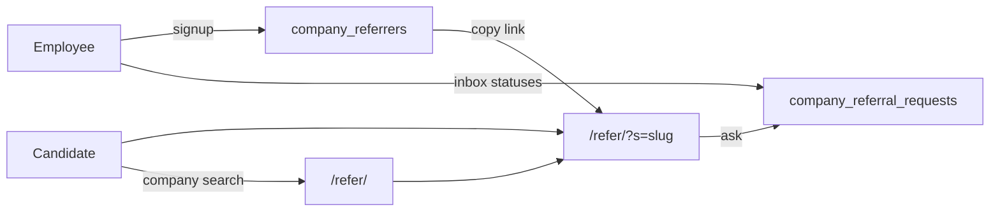

# Company referrer desk — HLD

Status: **v1 in progress** on production (Supabase project `Resume Builder`, `eiumlptnsmowvkxucprl`). There is no staging project.

Employee-referrer is a **desk**, not a rewards loop. An employee publishes “I work at X and can refer.” A candidate asks through a private link or a company search. The employee decides who to submit. Resunova never writes into the company’s ATS.

That is separate from **Profile → Referrals outreach** (`referral_contacts`, migration `021`): that table is “people I am asking.” This product is “people asking me.” It is also not the old friend-invite 20% / +7 Pro days card.

Schema of record: `db/migrations/044_company_referrers.sql`.

## Users

| Actor | What they do |
|---|---|
| Employee (referrer) | Sign up once, share a link, pause, move inbox statuses |
| Candidate | Open `/refer/?s=<slug>` or search a company, send name / email / role / pitch |
| Unsigned visitor | Can search and ask. Sign-in is optional for the ask form |

## Surfaces

1. **Profile → Referrals** (signed-in). Identity card + signup or live inbox. Same visual language as the profile hub. No rewards hero.
2. **`/refer/?s=<slug>`** (public). One person, one company, one form. Query param because the GitHub Pages static export cannot enumerate slugs at build time (`generateStaticParams`).
3. **`/refer/`** (public). Company search of employees who are **open**.

`/refer` is an AuthGate public route, same family as `/jobs` and `/r/`.

Later, not v1: a strip on a job page (“2 employees at Acme are open”).

On the same Profile tab, outreach stays **below** the desk:

- “I can refer” — `company_referrers` + inbox
- “I need a referral” — existing `referral_contacts` tracker

## Data

Two new tables, next to (not replacing) `referral_contacts`.

### `company_referrers` — one row per user

| Column | Role |
|---|---|
| `user_id` | Unique. Owner of the desk |
| `display_name`, `title`, `company`, `company_slug` | Public identity |
| `linkedin` | Optional public URL |
| `bio` | Roles they can refer for (free text) |
| `slug` | Public link key: `{name}-at-{company}-{6-char user suffix}` |
| `open_to_refer` | Public if true; hidden from search and slug page if paused |

Work email is **not** stored. A public `SELECT` policy would leak it. Work-email verification is a later feature and needs a private column plus a non-public policy.

### `company_referral_requests`

| Column | Role |
|---|---|
| `referrer_id` | Desk that received the ask |
| `candidate_user_id` | Optional. Set if the asker was signed in |
| `candidate_name`, `candidate_email`, `candidate_linkedin` | How the employee contacts them |
| `role`, `notes` | Role they want + 3-line pitch |
| `source` | `request` for asks from `/refer`. `submitted` is unused in the UI |
| `status` | `requested` → `reviewing` → `referred` \| `declined` |

Monthly counts on the desk are computed in the client from this inbox. No slot cap in v1.

## Access (RLS)

Client talks to Supabase with RLS. No new API route in v1. Same pattern as `lib/referralContacts.ts`.

| Action | Who |
|---|---|
| Read open referrer profiles | Anyone (`anon` + `authenticated`) |
| Write own referrer profile | Owner (`auth.uid() = user_id`) |
| Insert a request | Anyone, if that referrer is open. `candidate_user_id` must be null or `auth.uid()`. |
| Read requests | Referrer, or the candidate if `candidate_user_id` matches |
| Update request | Referrer only, and a trigger allows **status** only |
| Delete request | Referrer only |

Paused profiles drop out of search and the slug page shows “this referral link is not active.”

Anon can insert a request but cannot select it back. The public form inserts without `select()` and treats success as “Request sent.”

Guards in `045_company_referrer_guards.sql`:

- Length caps on identity and request fields
- One open request per email per referrer
- Max 40 open inbound requests per desk
- Anon cannot `SELECT user_id` on `company_referrers`
- Company search strips `%` / `_` wildcards
- LinkedIn / resume URLs must be `http` or `https`

## Flows

1. Employee fills name, company, title, optional LinkedIn, roles they can refer for, then **Sign up as a referrer**.
2. Desk shows identity card (Open / Paused), private share link, inbox, this-month counts.
3. Candidate opens the link, submits the ask. Copy on the form: Resunova does not submit into the company’s ATS.
4. Employee moves status in the inbox.

## File map

| Piece | Path |
|---|---|
| Schema | `db/migrations/044_company_referrers.sql`, `045_company_referrer_guards.sql`, `046_company_referrer_function_grants.sql` |
| Client + RLS helpers | `lib/companyReferrers.ts` |
| Signed-in desk | `components/profile/CompanyReferrerPanel.tsx` |
| Profile tab host | `components/profile/ProfileHubPanels.tsx` (`ReferralsPanel`) |
| Public ask + search | `app/refer/page.tsx` |
| Public route | `components/AuthGate.tsx` (`/refer`) |

## In v1 / not in v1

**In:** signup, edit profile after signup, roles, open/paused, private share link, inbox statuses, remove a request, company directory of open employees, duplicate-email and inbox-cap guards.

**Not:** ATS submit, cash or Pro-day rewards, work-email verification, auto alumni matching, showing paused people in search, job-page strip, monthly slot caps, email notify on a new ask, more than one company per account.

## Copy and UX constraints

- No emoji icons. SVGs only.
- No inaccurate trust copy (“No credit card”, “Privacy first”, “Free forever”).
- No em dashes in user-facing copy except the empty-value “—”.
- Sign-in stays the shared dialog. Do not invent a special referrer auth wall.
- Visual language matches the profile hub cards, not a rewards gradient.

## Production notes

- Apply `044` on the live Resume Builder project. Additive: two new tables, indexes, RLS, grants. Does not rewrite `referral_contacts`.
- Static export URLs must stay `/refer/?s=`. Do not add `app/refer/[slug]`.
- If the tables are missing, the desk should fail closed (empty / save error), not crash the Profile tab.
